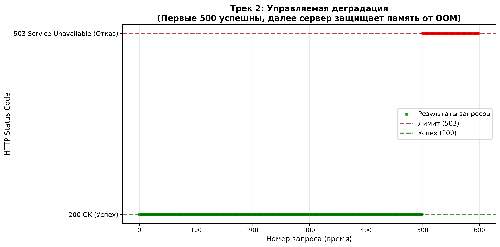

# Отчет по лабораторной работе №1
**Выполнила:** Жирнова Полина
**Целевая оценка:** 5  
**Выбранный трек:** 2. Управляемая деградация

---

## 1. Демонстрация жизненного цикла (Оценка «3»)

### Архитектура
- Приложение: FastAPI (Python 3.11)
- Хранение: in-memory (словари Python)
- Контейнеризация: Docker (python:3.11-slim)
- Порт: 8080 (внутри контейнера), 8081 (на хосте)

### Доказательство in-memory хранения
1. Создан пользователь: `POST /users` → получен `user_id = 2f7a407d-56f9-4088-8546-22120d3e5fc4`
2. Контейнер перезапущен: `docker restart lab1-test`
3. Попытка создать чат со старым `user_id` → сервер вернул `404 Not Found: User ... not found`

**Вывод:** Состояние хранится исключительно в памяти процесса и полностью сбрасывается при перезапуске контейнера. Никаких внешних хранилищ (PostgreSQL, Redis, файлы) не используется.

---

## 2. Защита от гонок и инфраструктура (Оценка «4»)

### Тест на гонки (Race Condition)
**Методика:**
- Создано 10 пользователей
- Создан 1 чат со всеми участниками
- 10 клиентов параллельно отправили 100 сообщений (по 10 от каждого)
- Использован `concurrent.futures.ThreadPoolExecutor(max_workers=10)`

**Результат:**

Отправлено: 100. Получено уникальных: 100
Тест на гонки пройден успешно! Состояние не повреждено.


**Вывод:** Параллельные запросы не повреждают базовые структуры данных. GIL Python + атомарные операции списков обеспечивают корректность.

### Инфраструктурные требования
- **Непривилегированный пользователь:** создан `appuser` (UID не 0), от которого работает процесс
- **Фиксация зависимостей:** `requirements.txt` с точными версиями, базовый образ `python:3.11-slim`
- **Healthcheck:** `HEALTHCHECK --interval=10s --timeout=3s CMD python -c "import urllib.request; urllib.request.urlopen('http://localhost:8080/health/ready')"`
- **SIGTERM:** обработчик `signal.signal(signal.SIGTERM, handle_sigterm)` корректно завершает процесс
- **.dockerignore:** исключает `__pycache__`, `.git`, `venv`, `.env`

---

## 3. Трек 2: Управляемая деградация (Оценка «5»)

### Гипотеза
Введение жесткого лимита на количество хранимых in-memory сообщений предотвратит исчерпание памяти (OOM) и краш сервера при высокой нагрузке, заменив его на предсказуемый отказ в обслуживании (HTTP 503).

### Методика
1. Установлен программный лимит: `MAX_MESSAGES_PER_CHAT = 500` (в `main.py`)
2. При превышении лимита сервер возвращает `HTTP 503 Service Unavailable` с сообщением `"Service overloaded: message limit reached"`
3. Написан скрипт `track2_test.py`, отправляющий 600 POST-запросов подряд в один чат от имени одного пользователя
4. Мониторинг возвращаемых HTTP-статусов и визуализация результата в виде точечной диаграммы (scatter plot)

### Результат
- **Запросы 1–500:** успешно обработаны (статус `200 OK`)
- **Запросы 501–600:** предсказуемо отклонены сервером (статус `503 Service Unavailable`)
- Сервер не упал, не потребовал перезагрузки и сохранил первые 500 подтвержденных сообщений
- График зависимости статуса от номера запроса приложен: `evidence/graph_track2.png`

**Визуализация:**


На графике четко видно:
- Зеленые точки (200 OK) до 500-го запроса
- Резкий обрыв на 501-м запросе
- Красные точки (503 Service Unavailable) после 500-го запроса

### Ограничения
- Сообщения, превышающие лимит, не сохраняются и не ставятся в очередь
- Лимит применяется на один чат, а не на весь сервер (можно расширить до глобального лимита)
- Это осознанный компромисс для гарантии стабильности системы (controlled degradation) в условиях in-memory архитектуры

### Почему это улучшение работает
In-memory хранилища уязвимы к исчерпанию памяти при неконтролируемом росте данных. Жесткий лимит превращает неопределенное поведение (OOM crash, swap thrashing) в детерминированное (HTTP 503). Клиент получает явный сигнал о перегрузке и может реализовать retry-логику с exponential backoff, вместо того чтобы ждать таймаута от упавшего сервера.

---

## 4. Команды для воспроизведения

```bash
# Сборка образа
docker build -t mtusi-lab1 .

# Запуск контейнера
docker run -d --name lab1-test -p 8081:8080 mtusi-lab1

# Проверка healthcheck
curl http://127.0.0.1:8081/health/ready

# Запуск теста на гонки (внутри контейнера)
docker exec lab1-test python test.py

# Запуск теста деградации (внутри контейнера)
docker exec lab1-test python track2_test.py

# Копирование графика на хост
docker cp lab1-test:/app/evidence/graph_track2.png ./evidence/graph_track2.png