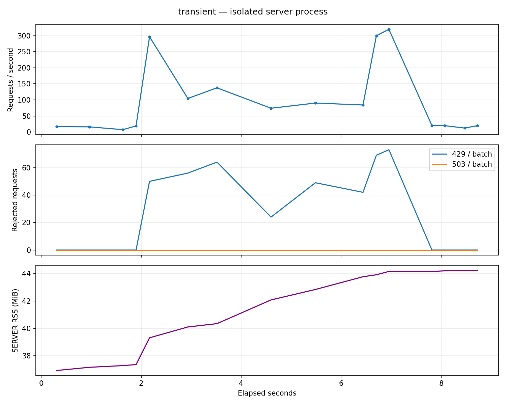
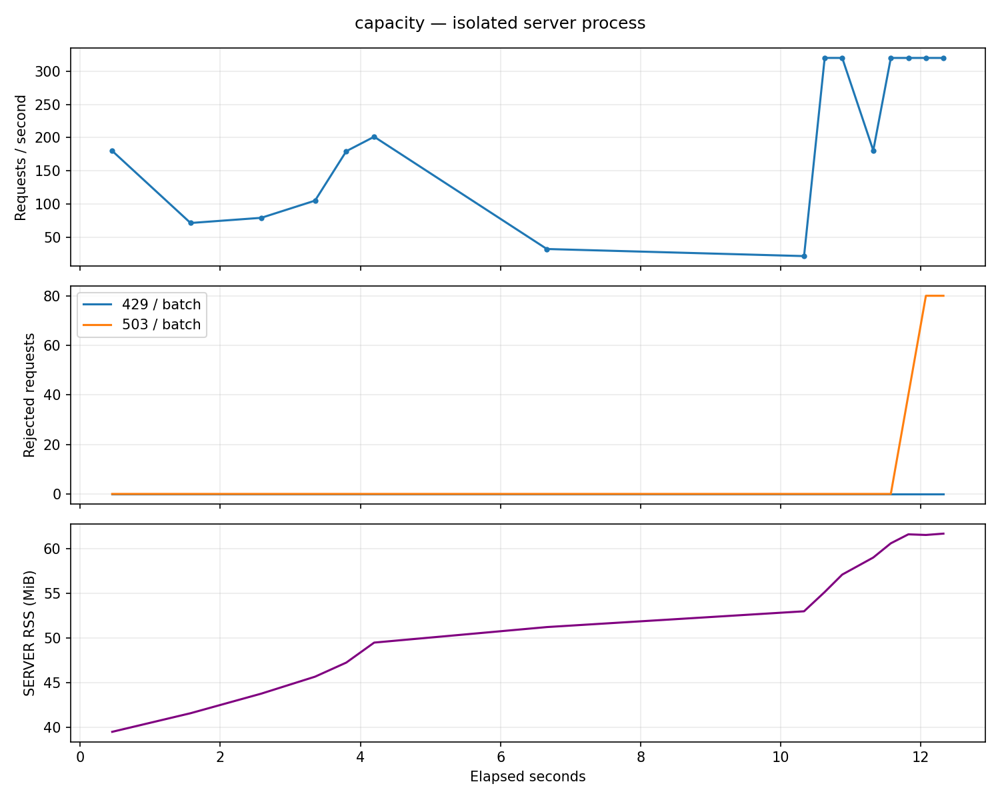

# Отчёт по лабораторной работе 1

Автор исходной работы: Жирнова Полина. Исправленная версия подготовлена с помощью ChatGPT; перед сдачей необходимо самостоятельно воспроизвести Docker-проверки и понимать реализацию.

Цель реализации: требования уровня 4 и исследование трека 2. Итоговую оценку определяет преподаватель. Ограничения по пунктам 20 и 22 явно перечислены ниже.

## Архитектура

Клиент → Uvicorn / FastAPI → Store в памяти единственного процесса. Данные не записываются на диск. Пользователи и чаты индексируются по UUID, имена — отдельным словарём, сообщения хранятся списками по чатам. Один RLock защищает связанные проверки и изменения. Запускается строго один worker. X-User-Id — учебная идентификация, не производственная аутентификация.

Все схемы и ошибки соответствуют приложенному контракту lab1. Страницы сортируются по (created_at, id), cursor подписан HMAC и привязан к области запроса. Время строго возрастает, что защищает порядок от отката системных часов, но может временно отличаться от wall clock. Snapshot между страницами не гарантируется. Прочитанная последняя страница не служит подпиской на новые сообщения.

## Фактически выполненные проверки — 06.11.2026

Среда: Linux, Python 3.12.14. Docker CLI отсутствует. Образ в этой среде НЕ собирался, контейнерные USER/HEALTHCHECK/сигналы здесь НЕ проверялись. Dockerfile использует python:3.12.8-slim-bookworm (фиксированный version tag, не immutable digest). Повторить Docker-команды из START_HERE.md на целевой машине обязательно.

| Проверка | Результат |
|---|---|
| make check | PASS: синтаксис Python и JSON |
| make validate | contracts/openapi.json: OK |
| Исходный tests/smoke.py через настоящий HTTP | PASS |
| test.py: отрицательные случаи, Unicode и страницы | PASS |
| 10 клиентов / 100 сообщений | 100 подтверждённых = 100 уникальных прочитанных; объекты совпали полностью |
| 10 конкурентных регистраций одного username | Одна 201, девять 409 |
| pytest student-tests | 4 passed; предупреждение deprecation из зависимости не влияет на результат |
| SIGTERM основного тестового процесса | 0,334 секунды; завершение lifecycle подтверждено логом |
| SIGTERM процессов исследования | 1,316 и 0,166 секунды; завершение lifecycle подтверждено логом |
| Новый процесс после остановки | Прежний X-User-Id → 401 |

Команды: `make check`, `make validate`, `make test`, `make test-own`, `make research`; при необходимости передайте PYTHON и BASE_URL. Для Windows команды без make указаны в START_HERE.md. Исследование запускает и останавливает отдельные процессы самостоятельно.

## Трек 2: гипотеза и механизм

Гипотеза: ограничение скорости записи даёт контролируемые отказы 429 при кратковременном всплеске и автоматическое восстановление при снижении нагрузки; глобальные пределы объектов предотвращают неограниченное накопление истории между чатами и дают 503 при заполнении. Подтверждённые сообщения сохраняются до остановки процесса.

Общий token bucket расходуется на успешные создания пользователей, чатов и сообщений. Чтение и health не расходуют жетоны. Запас пополняется по монотонным часам. Глобальные MAX_USERS, MAX_CHATS и MAX_MESSAGES действуют независимо от скорости; тело запроса ограничено MAX_BODY_BYTES, длина каждого поля — контрактом.

**Принципиальная граница:** временная перегрузка и полная память — разные ситуации. При полном хранилище записи не возобновляются просто после паузы, потому что данные не удаляются. Перезапуск теряет историю и не выдаётся за восстановление без потерь. Если по пункту 20 преподаватель требует именно освобождения заполненной ёмкости с сохранением всех данных, этот вариант не заявляет выполнения такого требования: потребуется согласованный механизм удаления/хранения или другая трактовка трека.

## Методика и результаты

Запуск `python track2_test.py` создаёт отдельный серверный PID и опрашивает его RSS через psutil. Тестовый процесс и matplotlib в RSS сервера не включены. Отправляются сообщения по 4000 emoji, то есть по верхней границе Unicode-длины. Внутри каждой партии до 20 параллельных HTTP-клиентов. Между партиями выдерживается минимум 0,25 секунды от начала предыдущей партии. Throughput на графике — число попыток, делённое на фактическую длительность партии, включая эту паузу; это не заявленный промышленный benchmark. RSS измеряется после партии, не непрерывно, поэтому краткие пики могут быть пропущены.

### Временный всплеск

WRITE_RATE=40, WRITE_BURST=20, MAX_MESSAGES=5000. Четыре партии по 5 запросов; восемь партий по 80; пауза 0,6 с; четыре партии по 5. После дополнительной паузы отдельный контрольный запрос.

- 680 основных попыток: 253 успешных создания, 427 отказов 429.
- После снижения нагрузки все партии recovery приняты; отдельный контрольный запрос — 201.
- Итого 254 подтверждённых сообщения, все 254 полностью совпали с прочитанной историей.
- Измеренный RSS сервера: 36,93–44,24 MiB.
- Сервер не перезапускался между перегрузкой и успешным восстановлением записи.

### Глобальная ёмкость

WRITE_RATE=10000, WRITE_BURST=10000, MAX_MESSAGES=1000. Шесть чатов, 15 партий по 80 попыток.

- 1200 попыток: 1000 приняты, 200 отклонены с 503; отказов 429 нет.
- Все 1000 подтверждённых объектов прочитаны и совпали полностью, без дублей.
- Измеренный RSS: 39,48–61,71 MiB; ready и чтение работают после заполнения.
- Автоматическое освобождение истории не выполняется и не заявляется.

Данные: evidence/transient.csv, evidence/capacity.csv, evidence/research-summary.json, evidence/research-run.txt. Каждый повтор может дать другие значения 429, RSS и времени; утверждения проверяются скриптом, а приведённые числа относятся только к сохранённому запуску.

## Ограничения исследования

Нет доказательства отсутствия OOM при произвольной нагрузке. Ограничены хранимые объекты и тело одного запроса, но остаются Python overhead, временные JSON, соединения и одновременные запросы. Значения лимитов нужно подбирать под доступную RAM; настройки по умолчанию не являются гарантией для контейнера с произвольно малым memory limit. Длительного stress-теста и cgroup OOM-теста не было.

Подтверждение 201 не означает долговечность после падения — по заданию данные только в RAM. Клиент, потерявший ответ, не знает, успела ли запись выполниться. Идемпотентность относится к дальнейшим лабораторным и здесь не реализуется.

Страницы сортируются и фильтруются в памяти, глобальная блокировка ограничивает throughput; это простое учебное решение, не масштабируемый промышленный мессенджер. При полном хранилище ready остаётся 200, поскольку обязательный путь безопасно читает данные и возвращает документированный отказ на запись. Внешних критичных зависимостей нет.

## Защищённые материалы

Контракт и публичные тесты, README, COURSE, CONTRIBUTING, MAINTAINERS и lab.json побайтно сохранены из приложенного архива eaea5f4. Контрольные суммы — evidence/protected-files.sha256. Источник доверенного skeleton преподавателя неизвестен; исходный репозиторий не помечен GitHub fork и не указывает parent. Поэтому пункт 22 нельзя считать независимо подтверждённым: перед сдачей сверить материалы с выданным преподавателем оригиналом.

## Конфигурация и воспроизведение

.env.example содержит все переменные, START_HERE.md — команды Docker, локального запуска, тестов, перезапуска и завершения. Зависимости закреплены, включая транзитивные. В образ для удобства проверки включены и тестовые зависимости — это увеличивает его размер. Python не требует стадии компиляции, поэтому Dockerfile одностадийный.

Логи: метод, шаблон маршрута, HTTP-статус, elapsed_ms и X-Request-Id; без содержимого сообщений и credentials. Uvicorn сам обрабатывает SIGTERM; timeout_graceful_shutdown=5. На Linux Uvicorn может после штатного shutdown повторно отправить себе SIGTERM: код -15 у subprocess (143 у Docker) сам по себе не означает аварийную потерю управления. Проверяются также время и запись Application shutdown complete.
